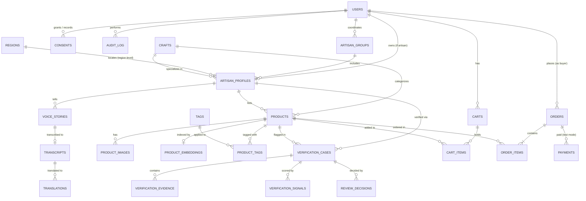

# HUNAR — Database Architecture & Schema Design (`database.md`)

| | |
|---|---|
| **Project** | Hunar (Capstone Project, 2 Semesters) |
| **Aligned With** | `srs.md` (v1.1), `project_scope.md`, `design.md` |
| **Problem Statement** | SIH26090 (MoSJE — Heritage & Culture) |
| **Database Engine** | PostgreSQL 16 |
| **Extensions** | `pgvector` (semantic & visual search), `pg_trgm` (fuzzy search), built-in Full-Text Search (`tsvector`) |
| **Status** | Updated to match SRS v1.1 & `design.md` entities |

---

## 1. Key Architectural Rules (Traced to SRS v1.1 & `design.md`)

1. **No Exact Artisan GPS (`[FR-PRO-09, FR-MAP-04, NFR-PRI-01]`):** `artisan_profiles` never stores `latitude` or `longitude`. Geographic coordinates exist **only** as region-level centroids in the `regions` table for the interactive India craft map.
2. **Unverified Publishing & Human-in-the-Loop Verification (`[FR-VER-01 to 16]`):** Artisans can publish immediately with `verification_status = 'unverified'`. Automated detection signals (`verification_signals`) produce a risk score (`low`, `medium`, `high`) to route cases to human verifiers (`review_decisions`)—**nothing is ever auto-rejected**.
3. **Private Original Image Retention (`[FR-LST-11, FR-VER-11, FR-VER-12]`):** `product_images` stores the `sha256_hash` and `original_storage_key` (in a **private** S3/R2/MinIO bucket) before any compression or public derivative (`public_url`, `thumbnail_url`, `blurhash`) is created.
4. **AI Listing Drafts Require Approval (`[FR-LST-07 to 10, NFR-REL-01]`):** Products created via AI always start as `status = 'draft'` and track `ai_generated` and `approved_by` / `approved_at` before moving to `published`.
5. **Multilingual Maker's Story (`[FR-STO-01 to 06]`):** Dedicated `voice_stories`, `transcripts`, and `translations` tables decouple audio capture (by artisan or coordinator) from async STT and translation jobs.
6. **Fair-Price Guidance Without Blocking (`[FR-PRI-01 to 05]`):** `price_references` stores reference bands, and `products` records whether an underpricing warning was shown and acknowledged—never blocking publication.
7. **Consent & Audit Trail (`[FR-ADM-05, NFR-PRI-02, NFR-SEC-03]`):** Dedicated `consents` (voice/image/video/evidence) and `audit_log` (verifier decisions, admin actions, private evidence access) tables.
8. **Pagination & Hybrid Search (`[FR-DIS-04, FR-DIS-09, FR-AIB-04]`):** Supports SRS-mandated offset pagination in batches of 12 with stable `ORDER BY (created_at DESC, id DESC)` (plus keyset-ready indexes), alongside hybrid search combining `tsvector`, `pg_trgm`, and `pgvector` via Reciprocal Rank Fusion (RRF).
9. **Test-Mode Payments Only (`[FR-ORD-04 to 06]`):** `payments` includes `is_test_mode` and `idempotency_key`; real-money settlement and payouts are excluded from Release 1.0.

---

## 2. Entity-Relationship Diagram (ERD)



---

## 3. Core Tables Summary & Semester Rollout

| Table | Purpose | Phase |
|---|---|---|
| `users`, `otp_verifications` | Accounts (artisan, buyer, coordinator, admin, verifier) + phone OTP auth | **S1** |
| `regions` | India craft regions (state, district, region centroid for map; no artisan GPS) | **S1** |
| `crafts` | Craft taxonomy + curated craft knowledge base for Craft-Info Assistant | **S1** |
| `artisan_groups` | SHGs / cooperatives managed by coordinators | **S1** |
| `artisan_profiles` | Storefront profile, shareable slug, craft, region, verification status | **S1** |
| `products`, `tags`, `product_tags` | Catalogue, AI draft/approval lifecycle, full-text `tsvector`, fair-price flags | **S1** |
| `product_images` | Private original + SHA-256, public compressed derivatives, BlurHash, 360° spin frames | **S1** |
| `product_embeddings` | `pgvector` text embeddings for semantic search & Craft Concierge RAG | **S2** |
| `voice_stories`, `transcripts`, `translations` | Maker's voice intro, STT transcript, multilingual translations | **S2** |
| `verification_cases`, `verification_evidence`, `verification_signals`, `review_decisions` | Replaceable detection signals, private evidence, risk score, human review queue | **S1 (basic) / S2 (pipeline)** |
| `price_references` | Reference price bands (p25/median/p75) for fair-price recommendations | **S2** |
| `carts`, `cart_items`, `orders`, `order_items`, `payments` | Shopping cart, order state machine, idempotent test-mode payments | **S1** |
| `consents` | Explicit consent records for voice, images, videos, and evidence | **S1** |
| `audit_log` | Immutable log of verification decisions, admin actions, and private media views | **S1** |

---

## 4. PostgreSQL 16 DDL Schema

### 4.1 Extensions & Shared Trigger

```sql
CREATE EXTENSION IF NOT EXISTS vector;   -- pgvector for semantic & visual embeddings
CREATE EXTENSION IF NOT EXISTS pg_trgm;  -- Trigram indexing for typo-tolerant search

CREATE OR REPLACE FUNCTION set_updated_at()
RETURNS TRIGGER AS $$
BEGIN
    NEW.updated_at = NOW();
    RETURN NEW;
END;
$$ LANGUAGE plpgsql;
```

### 4.2 Users, Roles & OTP Authentication (`[FR-AUTH]`)

```sql
CREATE TABLE users (
    id              UUID PRIMARY KEY DEFAULT gen_random_uuid(),
    role            VARCHAR(20) NOT NULL
                    CHECK (role IN ('artisan', 'buyer', 'coordinator', 'admin', 'verifier')),
    full_name       VARCHAR(120) NOT NULL,
    phone           VARCHAR(15) UNIQUE NOT NULL,        -- E.164 format e.g. +919876543210
    email           VARCHAR(255) UNIQUE,                -- Optional for artisans; used by buyers/admins
    password_hash   TEXT,                               -- Argon2 hash; nullable for OTP-only artisans
    preferred_lang  VARCHAR(10) NOT NULL DEFAULT 'hi',  -- Supported language code (TBD list)
    is_active       BOOLEAN NOT NULL DEFAULT TRUE,
    created_at      TIMESTAMPTZ NOT NULL DEFAULT NOW(),
    updated_at      TIMESTAMPTZ NOT NULL DEFAULT NOW()
);

CREATE TRIGGER trg_users_updated_at
BEFORE UPDATE ON users FOR EACH ROW EXECUTE FUNCTION set_updated_at();

CREATE TABLE otp_verifications (
    id              UUID PRIMARY KEY DEFAULT gen_random_uuid(),
    phone           VARCHAR(15) NOT NULL,
    otp_hash        TEXT NOT NULL,                      -- Hashed 6-digit OTP
    purpose         VARCHAR(20) NOT NULL
                    CHECK (purpose IN ('login', 'register', 'password_reset')),
    attempts        SMALLINT NOT NULL DEFAULT 0,
    expires_at      TIMESTAMPTZ NOT NULL,               -- ~5 minutes
    consumed_at     TIMESTAMPTZ,
    created_at      TIMESTAMPTZ NOT NULL DEFAULT NOW()
);
```

### 4.3 Regions, Crafts & Artisan Storefronts (`[FR-PRO, FR-MAP]`)

```sql
-- Region-level geography ONLY (centroids for India Craft Map; never exact artisan GPS)
CREATE TABLE regions (
    id              UUID PRIMARY KEY DEFAULT gen_random_uuid(),
    state           VARCHAR(80) NOT NULL,
    district        VARCHAR(80) NOT NULL,
    region_name     VARCHAR(120) NOT NULL,              -- e.g., Kutch, Madhubani, Channapatna
    slug            VARCHAR(140) UNIQUE NOT NULL,
    center_lat      DECIMAL(9, 6),                      -- Region centroid only [FR-MAP-04]
    center_lng      DECIMAL(9, 6),
    created_at      TIMESTAMPTZ NOT NULL DEFAULT NOW(),
    UNIQUE (state, district, region_name)
);

-- Craft taxonomy + curated craft knowledge base for Craft-Info Assistant [FR-AIB-06]
CREATE TABLE crafts (
    id                  UUID PRIMARY KEY DEFAULT gen_random_uuid(),
    name                VARCHAR(120) UNIQUE NOT NULL,   -- e.g., Madhubani Painting, Blue Pottery
    slug                VARCHAR(140) UNIQUE NOT NULL,
    short_description   TEXT,
    heritage_notes      TEXT,                           -- Curated trusted info for RAG
    source_reference    TEXT,                           -- Provenance of trusted craft info
    icon_url            TEXT,
    is_active           BOOLEAN NOT NULL DEFAULT TRUE,
    created_at          TIMESTAMPTZ NOT NULL DEFAULT NOW()
);

-- SHGs / Cooperatives assisted by a Coordinator
CREATE TABLE artisan_groups (
    id              UUID PRIMARY KEY DEFAULT gen_random_uuid(),
    name            VARCHAR(150) NOT NULL,
    coordinator_id  UUID REFERENCES users(id) ON DELETE SET NULL,
    region_id       UUID REFERENCES regions(id) ON DELETE SET NULL,
    description     TEXT,
    created_at      TIMESTAMPTZ NOT NULL DEFAULT NOW(),
    updated_at      TIMESTAMPTZ NOT NULL DEFAULT NOW()
);

CREATE TRIGGER trg_artisan_groups_updated_at
BEFORE UPDATE ON artisan_groups FOR EACH ROW EXECUTE FUNCTION set_updated_at();

-- Storefront profile inside the shared Hunar marketplace [FR-PRO-01 to 09]
CREATE TABLE artisan_profiles (
    id                  UUID PRIMARY KEY DEFAULT gen_random_uuid(),
    user_id             UUID UNIQUE NOT NULL REFERENCES users(id) ON DELETE CASCADE,
    group_id            UUID REFERENCES artisan_groups(id) ON DELETE SET NULL,
    onboarded_by        UUID REFERENCES users(id) ON DELETE SET NULL, -- Coordinator if assisted
    display_name        VARCHAR(120) NOT NULL,
    slug                VARCHAR(150) UNIQUE NOT NULL,   -- Shareable storefront URL [FR-PRO-07]
    profile_photo_url   TEXT,                           -- Optional (shy/non-photogenic artisans)
    primary_craft_id    UUID REFERENCES crafts(id) ON DELETE SET NULL,
    region_id           UUID NOT NULL REFERENCES regions(id) ON DELETE RESTRICT,
    village_or_town     VARCHAR(100),                   -- Village/region level only; NO exact GPS
    bio                 TEXT,
    verification_status VARCHAR(20) NOT NULL DEFAULT 'unverified'
                        CHECK (verification_status IN ('unverified', 'pending_review', 'verified', 'suspended')),
    verified_at         TIMESTAMPTZ,
    is_featured         BOOLEAN NOT NULL DEFAULT FALSE, -- Home page featured artisans [FR-MKT-03]
    created_at          TIMESTAMPTZ NOT NULL DEFAULT NOW(),
    updated_at          TIMESTAMPTZ NOT NULL DEFAULT NOW()
);

CREATE TRIGGER trg_artisan_profiles_updated_at
BEFORE UPDATE ON artisan_profiles FOR EACH ROW EXECUTE FUNCTION set_updated_at();
```

### 4.4 Products, Images, Tags & Embeddings (`[FR-LST, FR-DIS, FR-VIEW, FR-AIB, FR-PRI]`)

```sql
CREATE TABLE products (
    id                              UUID PRIMARY KEY DEFAULT gen_random_uuid(),
    artisan_id                      UUID NOT NULL REFERENCES artisan_profiles(id) ON DELETE CASCADE,
    craft_id                        UUID NOT NULL REFERENCES crafts(id) ON DELETE RESTRICT,
    created_by                      UUID NOT NULL REFERENCES users(id) ON DELETE RESTRICT, -- Artisan or Coordinator
    title                           VARCHAR(180) NOT NULL,
    slug                            VARCHAR(220) UNIQUE NOT NULL,
    description                     TEXT,
    materials                       TEXT[],             -- e.g., ARRAY['Terracotta', 'Natural Dye']
    dimensions_text                 VARCHAR(100),
    price_inr                       NUMERIC(10, 2) NOT NULL CHECK (price_inr > 0),
    stock_quantity                  INTEGER NOT NULL DEFAULT 1 CHECK (stock_quantity >= 0),

    -- Fair-Price Guidance (warns without blocking [FR-PRI-01 to 05])
    suggested_price_min_inr         NUMERIC(10, 2),
    suggested_price_max_inr         NUMERIC(10, 2),
    underpricing_warning_shown      BOOLEAN NOT NULL DEFAULT FALSE,
    artisan_acknowledged_warning    BOOLEAN NOT NULL DEFAULT FALSE,

    -- AI Listing Draft & Approval Lifecycle [FR-LST-07 to 10]
    is_ai_assisted                  BOOLEAN NOT NULL DEFAULT FALSE,
    ai_raw_draft                    JSONB,              -- Original LLM structured output
    status                          VARCHAR(25) NOT NULL DEFAULT 'draft'
                                    CHECK (status IN ('draft', 'published', 'flagged_review', 'out_of_stock', 'archived')),
    approved_by                     UUID REFERENCES users(id) ON DELETE SET NULL,
    approved_at                     TIMESTAMPTZ,

    -- Full-text search vector (updated via trigger or app)
    search_vector                   TSVECTOR,

    created_at                      TIMESTAMPTZ NOT NULL DEFAULT NOW(),
    updated_at                      TIMESTAMPTZ NOT NULL DEFAULT NOW()
);

CREATE TRIGGER trg_products_updated_at
BEFORE UPDATE ON products FOR EACH ROW EXECUTE FUNCTION set_updated_at();

-- Auto-maintain tsvector for keyword search [FR-DIS-02]
CREATE OR REPLACE FUNCTION products_search_vector_update()
RETURNS TRIGGER AS $$
BEGIN
    NEW.search_vector :=
        setweight(to_tsvector('english', COALESCE(NEW.title, '')), 'A') ||
        setweight(to_tsvector('english', COALESCE(NEW.description, '')), 'B') ||
        setweight(to_tsvector('english', COALESCE(array_to_string(NEW.materials, ' '), '')), 'C');
    RETURN NEW;
END;
$$ LANGUAGE plpgsql;

CREATE TRIGGER trg_products_search_vector
BEFORE INSERT OR UPDATE OF title, description, materials ON products
FOR EACH ROW EXECUTE FUNCTION products_search_vector_update();

-- Product Photos: Private Original + SHA-256 + Public Compressed + 360° Spin [FR-LST-11, FR-VER-11, FR-VIEW-02]
CREATE TABLE product_images (
    id                      UUID PRIMARY KEY DEFAULT gen_random_uuid(),
    product_id              UUID NOT NULL REFERENCES products(id) ON DELETE CASCADE,

    -- Private original retained BEFORE compression [FR-LST-11, FR-VER-11, FR-VER-12]
    original_storage_key    TEXT NOT NULL,              -- Private bucket object key
    sha256_hash             CHAR(64) NOT NULL,          -- Computed on original bytes

    -- Public low-bandwidth derivatives (EXIF & GPS stripped) [NFR-PER-02, NFR-PRI-01]
    public_url              TEXT,
    thumbnail_url           TEXT,
    blurhash                VARCHAR(64),

    -- Display & 360° Photo Spin [FR-VIEW-02]
    is_primary              BOOLEAN NOT NULL DEFAULT FALSE,
    display_order           SMALLINT NOT NULL DEFAULT 0,
    is_spin_frame           BOOLEAN NOT NULL DEFAULT FALSE,
    spin_frame_order        SMALLINT,

    -- Visual verification signals
    perceptual_hash         VARCHAR(64),                -- pHash / dHash
    image_embedding         VECTOR(512),                -- CLIP embedding for similarity checks

    created_at              TIMESTAMPTZ NOT NULL DEFAULT NOW()
);

-- Separate embedding table so models can be swapped cleanly [FR-AIB-04]
CREATE TABLE product_embeddings (
    product_id      UUID PRIMARY KEY REFERENCES products(id) ON DELETE CASCADE,
    model_name      VARCHAR(80) NOT NULL,               -- e.g., bge-m3, multilingual-e5
    embedding       VECTOR(768) NOT NULL,
    updated_at      TIMESTAMPTZ NOT NULL DEFAULT NOW()
);

CREATE TABLE tags (
    id              UUID PRIMARY KEY DEFAULT gen_random_uuid(),
    name            VARCHAR(60) UNIQUE NOT NULL,
    slug            VARCHAR(80) UNIQUE NOT NULL
);

CREATE TABLE product_tags (
    product_id      UUID NOT NULL REFERENCES products(id) ON DELETE CASCADE,
    tag_id          UUID NOT NULL REFERENCES tags(id) ON DELETE CASCADE,
    PRIMARY KEY (product_id, tag_id)
);
```

### 4.5 Maker's Story, Transcripts & Translations (`[FR-STO-01 to 06]`)

```sql
CREATE TABLE voice_stories (
    id                  UUID PRIMARY KEY DEFAULT gen_random_uuid(),
    artisan_id          UUID NOT NULL REFERENCES artisan_profiles(id) ON DELETE CASCADE,
    recorded_by         UUID NOT NULL REFERENCES users(id) ON DELETE RESTRICT, -- Artisan or Coordinator
    original_audio_key  TEXT NOT NULL,                  -- Private bucket (WebM/Opus or WAV)
    public_audio_url    TEXT,                           -- Compressed public audio for buyers
    duration_seconds    INTEGER CHECK (duration_seconds > 0),
    source_language     VARCHAR(10) NOT NULL,
    processing_status   VARCHAR(20) NOT NULL DEFAULT 'uploaded'
                        CHECK (processing_status IN ('uploaded', 'transcribing', 'translating', 'ready', 'failed')),
    is_active           BOOLEAN NOT NULL DEFAULT TRUE,
    created_at          TIMESTAMPTZ NOT NULL DEFAULT NOW(),
    updated_at          TIMESTAMPTZ NOT NULL DEFAULT NOW()
);

CREATE TRIGGER trg_voice_stories_updated_at
BEFORE UPDATE ON voice_stories FOR EACH ROW EXECUTE FUNCTION set_updated_at();

CREATE TABLE transcripts (
    id                  UUID PRIMARY KEY DEFAULT gen_random_uuid(),
    voice_story_id      UUID UNIQUE NOT NULL REFERENCES voice_stories(id) ON DELETE CASCADE,
    language_code       VARCHAR(10) NOT NULL,
    raw_text            TEXT NOT NULL,
    edited_text         TEXT,                           -- If artisan/coordinator corrected it
    stt_provider        VARCHAR(50) NOT NULL,           -- e.g., sarvam, bhashini, whisper
    confidence_score    NUMERIC(5, 4),
    created_at          TIMESTAMPTZ NOT NULL DEFAULT NOW(),
    updated_at          TIMESTAMPTZ NOT NULL DEFAULT NOW()
);

CREATE TRIGGER trg_transcripts_updated_at
BEFORE UPDATE ON transcripts FOR EACH ROW EXECUTE FUNCTION set_updated_at();

CREATE TABLE translations (
    id                      UUID PRIMARY KEY DEFAULT gen_random_uuid(),
    transcript_id           UUID NOT NULL REFERENCES transcripts(id) ON DELETE CASCADE,
    target_language         VARCHAR(10) NOT NULL,
    translated_text         TEXT NOT NULL,
    translation_provider    VARCHAR(50) NOT NULL,       -- e.g., bhashini, indictrans2, google
    created_at              TIMESTAMPTZ NOT NULL DEFAULT NOW(),
    UNIQUE (transcript_id, target_language)
);
```

### 4.6 Verification Pipeline & Human Review (`[FR-VER, FR-ADM]`)

```sql
-- Covers both Artisan Verification (Verified badge) and Flagged Product Reviews
CREATE TABLE verification_cases (
    id                  UUID PRIMARY KEY DEFAULT gen_random_uuid(),
    case_type           VARCHAR(25) NOT NULL
                        CHECK (case_type IN ('artisan_verification', 'flagged_listing')),
    artisan_id          UUID NOT NULL REFERENCES artisan_profiles(id) ON DELETE CASCADE,
    product_id          UUID REFERENCES products(id) ON DELETE CASCADE, -- NULL for artisan-level cases
    risk_score          NUMERIC(5, 4) CHECK (risk_score BETWEEN 0.0000 AND 1.0000),
    risk_level          VARCHAR(10)
                        CHECK (risk_level IN ('low', 'medium', 'high')),
    status              VARCHAR(25) NOT NULL DEFAULT 'open'
                        CHECK (status IN ('open', 'in_review', 'approved', 'rejected', 'needs_more_info')),
    assigned_verifier_id UUID REFERENCES users(id) ON DELETE SET NULL,
    created_at          TIMESTAMPTZ NOT NULL DEFAULT NOW(),
    updated_at          TIMESTAMPTZ NOT NULL DEFAULT NOW()
);

CREATE TRIGGER trg_verification_cases_updated_at
BEFORE UPDATE ON verification_cases FOR EACH ROW EXECUTE FUNCTION set_updated_at();

-- Private evidence (ID/craft proof, no-face making video, coordinator vouching) [FR-VER-04, 08, 09]
-- Privacy note: Avoid collecting raw Aadhaar numbers; store only approved craft/ID proof in private bucket
CREATE TABLE verification_evidence (
    id                  UUID PRIMARY KEY DEFAULT gen_random_uuid(),
    case_id             UUID NOT NULL REFERENCES verification_cases(id) ON DELETE CASCADE,
    submitted_by        UUID NOT NULL REFERENCES users(id) ON DELETE RESTRICT, -- Artisan or Coordinator
    evidence_type       VARCHAR(30) NOT NULL
                        CHECK (evidence_type IN ('craft_or_id_proof', 'making_process_video', 'coordinator_vouching', 'other')),
    private_storage_key TEXT,                           -- Private bucket key (NULL for text-only vouching)
    sha256_hash         CHAR(64),
    notes               TEXT,
    created_at          TIMESTAMPTZ NOT NULL DEFAULT NOW()
);

-- Replaceable automated detection signals [FR-VER-13 to 15]
CREATE TABLE verification_signals (
    id                  UUID PRIMARY KEY DEFAULT gen_random_uuid(),
    case_id             UUID NOT NULL REFERENCES verification_cases(id) ON DELETE CASCADE,
    product_image_id    UUID REFERENCES product_images(id) ON DELETE SET NULL,
    signal_type         VARCHAR(35) NOT NULL
                        CHECK (signal_type IN (
                            'sha256_duplicate', 'phash_near_duplicate', 'clip_similarity',
                            'ai_image_detector', 'exif_metadata', 'c2pa_provenance',
                            'screen_recapture', 'ela_tampering', 'video_keyframe_consistency'
                        )),
    detector_component  VARCHAR(80) NOT NULL,           -- e.g., open_clip_v1, exifr, hive_api
    score               NUMERIC(5, 4) NOT NULL CHECK (score BETWEEN 0.0000 AND 1.0000),
    weight              NUMERIC(4, 3),
    raw_payload         JSONB,                          -- Full detector output for evaluation
    created_at          TIMESTAMPTZ NOT NULL DEFAULT NOW()
);

-- Human-only final decisions (never auto-rejected [FR-VER-10, 16, FR-ADM-03])
CREATE TABLE review_decisions (
    id                  UUID PRIMARY KEY DEFAULT gen_random_uuid(),
    case_id             UUID NOT NULL REFERENCES verification_cases(id) ON DELETE CASCADE,
    reviewer_id         UUID NOT NULL REFERENCES users(id) ON DELETE RESTRICT,
    decision            VARCHAR(25) NOT NULL
                        CHECK (decision IN ('approved', 'rejected', 'needs_more_info')),
    rationale           TEXT NOT NULL,
    created_at          TIMESTAMPTZ NOT NULL DEFAULT NOW()
);
```

### 4.7 Fair-Price References (`[FR-PRI]`)

```sql
CREATE TABLE price_references (
    id                  UUID PRIMARY KEY DEFAULT gen_random_uuid(),
    craft_id            UUID NOT NULL REFERENCES crafts(id) ON DELETE CASCADE,
    region_id           UUID REFERENCES regions(id) ON DELETE SET NULL,
    material_tag        VARCHAR(80),
    size_bucket         VARCHAR(30),                    -- e.g., small, medium, large
    p25_price_inr       NUMERIC(10, 2) NOT NULL CHECK (p25_price_inr > 0),
    median_price_inr    NUMERIC(10, 2) NOT NULL CHECK (median_price_inr > 0),
    p75_price_inr       NUMERIC(10, 2) NOT NULL CHECK (p75_price_inr > 0),
    sample_size         INTEGER NOT NULL DEFAULT 1,
    data_source         VARCHAR(120) NOT NULL,          -- Documented source [FR-PRI-06]
    updated_at          TIMESTAMPTZ NOT NULL DEFAULT NOW()
);
```

### 4.8 Cart, Orders & Test-Mode Payments (`[FR-ORD]`)

```sql
CREATE TABLE carts (
    id              UUID PRIMARY KEY DEFAULT gen_random_uuid(),
    buyer_id        UUID UNIQUE NOT NULL REFERENCES users(id) ON DELETE CASCADE,
    created_at      TIMESTAMPTZ NOT NULL DEFAULT NOW(),
    updated_at      TIMESTAMPTZ NOT NULL DEFAULT NOW()
);

CREATE TRIGGER trg_carts_updated_at
BEFORE UPDATE ON carts FOR EACH ROW EXECUTE FUNCTION set_updated_at();

CREATE TABLE cart_items (
    id              UUID PRIMARY KEY DEFAULT gen_random_uuid(),
    cart_id         UUID NOT NULL REFERENCES carts(id) ON DELETE CASCADE,
    product_id      UUID NOT NULL REFERENCES products(id) ON DELETE CASCADE,
    quantity        INTEGER NOT NULL DEFAULT 1 CHECK (quantity > 0),
    created_at      TIMESTAMPTZ NOT NULL DEFAULT NOW(),
    updated_at      TIMESTAMPTZ NOT NULL DEFAULT NOW(),
    UNIQUE (cart_id, product_id)
);

CREATE TRIGGER trg_cart_items_updated_at
BEFORE UPDATE ON cart_items FOR EACH ROW EXECUTE FUNCTION set_updated_at();

CREATE TABLE orders (
    id                  UUID PRIMARY KEY DEFAULT gen_random_uuid(),
    order_number        VARCHAR(30) UNIQUE NOT NULL,    -- e.g., HNR-20261128-0001
    buyer_id            UUID NOT NULL REFERENCES users(id) ON DELETE RESTRICT,
    shipping_address    JSONB NOT NULL,                 -- Snapshot of delivery address
    total_amount_inr    NUMERIC(10, 2) NOT NULL CHECK (total_amount_inr >= 0),
    -- Order state machine [design.md §3.5]
    status              VARCHAR(20) NOT NULL DEFAULT 'created'
                        CHECK (status IN ('created', 'payment_pending', 'paid', 'failed', 'shipped', 'delivered', 'cancelled')),
    idempotency_key     VARCHAR(100) UNIQUE,
    created_at          TIMESTAMPTZ NOT NULL DEFAULT NOW(),
    updated_at          TIMESTAMPTZ NOT NULL DEFAULT NOW()
);

CREATE TRIGGER trg_orders_updated_at
BEFORE UPDATE ON orders FOR EACH ROW EXECUTE FUNCTION set_updated_at();

CREATE TABLE order_items (
    id                  UUID PRIMARY KEY DEFAULT gen_random_uuid(),
    order_id            UUID NOT NULL REFERENCES orders(id) ON DELETE CASCADE,
    product_id          UUID NOT NULL REFERENCES products(id) ON DELETE RESTRICT,
    artisan_id          UUID NOT NULL REFERENCES artisan_profiles(id) ON DELETE RESTRICT,
    product_title_snap  VARCHAR(180) NOT NULL,
    unit_price_inr      NUMERIC(10, 2) NOT NULL CHECK (unit_price_inr > 0),
    quantity            INTEGER NOT NULL CHECK (quantity > 0),
    created_at          TIMESTAMPTZ NOT NULL DEFAULT NOW()
);

-- Payment gateway TEST MODE only; no real settlement/payouts in v1.0 [FR-ORD-04 to 06]
CREATE TABLE payments (
    id                  UUID PRIMARY KEY DEFAULT gen_random_uuid(),
    order_id            UUID NOT NULL REFERENCES orders(id) ON DELETE RESTRICT,
    gateway             VARCHAR(30) NOT NULL,           -- razorpay | stripe
    gateway_order_id    VARCHAR(120),
    gateway_payment_id  VARCHAR(120) UNIQUE,
    amount_inr          NUMERIC(10, 2) NOT NULL CHECK (amount_inr >= 0),
    status              VARCHAR(20) NOT NULL
                        CHECK (status IN ('created', 'authorized', 'paid', 'failed', 'refunded')),
    is_test_mode        BOOLEAN NOT NULL DEFAULT TRUE CHECK (is_test_mode = TRUE),
    idempotency_key     VARCHAR(100) UNIQUE,
    raw_payload         JSONB,                          -- Recorded gateway test result [FR-ORD-06]
    created_at          TIMESTAMPTZ NOT NULL DEFAULT NOW(),
    updated_at          TIMESTAMPTZ NOT NULL DEFAULT NOW()
);

CREATE TRIGGER trg_payments_updated_at
BEFORE UPDATE ON payments FOR EACH ROW EXECUTE FUNCTION set_updated_at();
```

### 4.9 Consents & Audit Log (`[NFR-PRI-02, FR-ADM-05, NFR-SEC-03]`)

```sql
CREATE TABLE consents (
    id                  UUID PRIMARY KEY DEFAULT gen_random_uuid(),
    subject_user_id     UUID NOT NULL REFERENCES users(id) ON DELETE CASCADE,
    recorded_by_user_id UUID NOT NULL REFERENCES users(id) ON DELETE RESTRICT, -- Artisan or Coordinator
    consent_type        VARCHAR(30) NOT NULL
                        CHECK (consent_type IN ('voice_recording', 'product_images', 'making_video', 'verification_evidence')),
    consent_version     VARCHAR(20) NOT NULL DEFAULT 'v1.0',
    granted_at          TIMESTAMPTZ NOT NULL DEFAULT NOW(),
    revoked_at          TIMESTAMPTZ
);

CREATE TABLE audit_log (
    id                  UUID PRIMARY KEY DEFAULT gen_random_uuid(),
    actor_user_id       UUID REFERENCES users(id) ON DELETE SET NULL,
    action              VARCHAR(60) NOT NULL,           -- e.g., 'view_private_evidence', 'verification_approved'
    entity_type         VARCHAR(40) NOT NULL,           -- e.g., 'verification_case', 'product', 'artisan_profile'
    entity_id           UUID NOT NULL,
    metadata            JSONB,
    ip_address          INET,
    created_at          TIMESTAMPTZ NOT NULL DEFAULT NOW()
);
```

---

## 5. Indexing Strategy

```sql
-- 1. Product Discovery & Stable Pagination (Offset of 12 + Keyset-ready) [FR-DIS-04, FR-DIS-09]
CREATE INDEX idx_products_published_feed
    ON products (created_at DESC, id DESC)
    WHERE status = 'published';

CREATE INDEX idx_products_craft_price
    ON products (craft_id, price_inr)
    WHERE status = 'published';

-- 2. Full-Text & Fuzzy Search [FR-DIS-02]
CREATE INDEX idx_products_search_vector_gin
    ON products USING gin (search_vector);

CREATE INDEX idx_products_title_trgm
    ON products USING gin (title gin_trgm_ops);

-- 3. Semantic & Visual Similarity Search (pgvector HNSW) [FR-AIB-04, FR-VER-14]
CREATE INDEX idx_product_embeddings_hnsw
    ON product_embeddings USING hnsw (embedding vector_cosine_ops);

CREATE INDEX idx_product_images_clip_hnsw
    ON product_images USING hnsw (image_embedding vector_cosine_ops);

-- 4. Exact & Near-Duplicate Image Lookups [FR-VER-12, FR-VER-14]
CREATE INDEX idx_product_images_sha256 ON product_images (sha256_hash);
CREATE INDEX idx_product_images_phash ON product_images (perceptual_hash) WHERE perceptual_hash IS NOT NULL;

-- 5. Verification Queue & Audit Lookups [FR-ADM]
CREATE INDEX idx_verification_cases_queue
    ON verification_cases (status, risk_score DESC, created_at ASC)
    WHERE status IN ('open', 'in_review');

CREATE INDEX idx_audit_log_entity ON audit_log (entity_type, entity_id, created_at DESC);

-- 6. Auth & Orders
CREATE INDEX idx_otp_phone_active ON otp_verifications (phone, expires_at DESC) WHERE consumed_at IS NULL;
CREATE INDEX idx_orders_buyer_recent ON orders (buyer_id, created_at DESC);
```

---

## 6. Key Query Patterns

### 6.1 Product Feed — Offset Pagination (Batches of 12) (`[FR-DIS-04, FR-DIS-09]`)

```sql
SELECT
    p.id, p.title, p.slug, p.price_inr, p.created_at,
    ap.display_name AS artisan_name, ap.slug AS artisan_slug, ap.verification_status,
    r.region_name, r.state,
    pi.thumbnail_url, pi.blurhash
FROM products p
JOIN artisan_profiles ap ON ap.id = p.artisan_id
JOIN regions r ON r.id = ap.region_id
LEFT JOIN product_images pi ON pi.product_id = p.id AND pi.is_primary = TRUE
WHERE p.status = 'published'
ORDER BY p.created_at DESC, p.id DESC
LIMIT 12 OFFSET $1;
```

### 6.2 Hybrid Search with Reciprocal Rank Fusion (RRF) (`[FR-DIS-02, FR-AIB-04]`)

```sql
WITH keyword_search AS (
    SELECT id, ROW_NUMBER() OVER (ORDER BY ts_rank(search_vector, plainto_tsquery('english', $1)) DESC) AS rank
    FROM products
    WHERE status = 'published'
      AND (search_vector @@ plainto_tsquery('english', $1) OR title % $1)
    LIMIT 40
),
semantic_search AS (
    SELECT pe.product_id AS id, ROW_NUMBER() OVER (ORDER BY pe.embedding <=> $2::vector) AS rank
    FROM product_embeddings pe
    JOIN products p ON p.id = pe.product_id
    WHERE p.status = 'published'
    LIMIT 40
)
SELECT
    COALESCE(k.id, s.id) AS product_id,
    COALESCE(1.0 / (60 + k.rank), 0.0) + COALESCE(1.0 / (60 + s.rank), 0.0) AS rrf_score
FROM keyword_search k
FULL OUTER JOIN semantic_search s ON k.id = s.id
ORDER BY rrf_score DESC
LIMIT 12;
```

### 6.3 India Craft-Region Map Aggregation (`[FR-MAP-01 to 04]`)

```sql
SELECT
    r.id, r.state, r.district, r.region_name, r.center_lat, r.center_lng,
    COUNT(DISTINCT ap.id) AS artisan_count,
    COUNT(DISTINCT p.id) AS published_product_count
FROM regions r
JOIN artisan_profiles ap ON ap.region_id = r.id
LEFT JOIN products p ON p.artisan_id = ap.id AND p.status = 'published'
GROUP BY r.id
ORDER BY published_product_count DESC;
```

---

## 7. Local Development Setup (Docker + PostgreSQL 16)

```bash
# Port 5433 avoids conflicts with local PostgreSQL installations
docker run --name hunar-pg \
  -e POSTGRES_USER=hunar_admin \
  -e POSTGRES_PASSWORD=hunar_dev_pass \
  -e POSTGRES_DB=hunar_db \
  -p 5433:5432 \
  -d pgvector/pgvector:pg16
```

---

## 8. Explicitly Out of Scope / Deferred (Release 1.0)

Per `project_scope.md` §7 and `srs.md` §9.2 & §12, the following tables are **intentionally omitted**:
* **Ratings & Reviews** (`reviews`, `avg_rating`) — deferred from Release 1.0.
* **Buyer–Artisan Messaging** (`conversations`, `messages`) — deferred from Release 1.0.
* **Notifications** (`notifications`) — deferred from Release 1.0.
* **Artisan CRM** (`campaigns`, `leads`, `segments`) — out of scope.
* **Real-Money Payouts / Settlements** — out of scope (`payments.is_test_mode` is enforced `TRUE`).
* **NFTs / Blockchain Provenance** — out of scope.